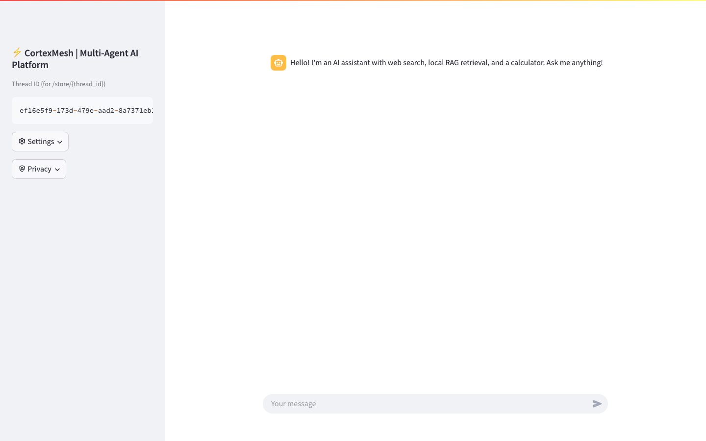
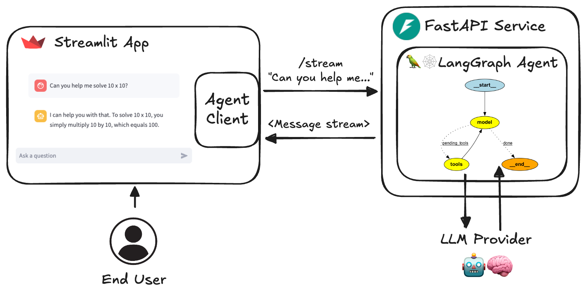

# ⚡ CortexMesh

<p align="center">
  
  
  
  
  
  
  
</p>

<h1 align="center">
  Build AI Systems That <br/>
  <strong>Think Beyond One Prompt.</strong>
</h1>

<p align="center">
  <b>Plan. Retrieve. Reason. Collaborate. Execute. Verify.</b>
</p>

<p align="center">
  <b>CortexMesh</b> is an enterprise-grade multi-agent AI platform built around 
  <br/>
  <b>LangGraph orchestration</b>, <b>hybrid RAG</b>, <b>dynamic knowledge graphs</b>, <b>MCP tool bridges</b>, 
  <br/>
  <b>human-in-the-loop oversight</b>, <b>persistent state checkpointing</b>, and <b>real-time streaming</b>.
</p>

<p align="center">
  <a href="#-frontend-showcase">Frontend Showcase</a> •
  <a href="#-interactive-runtime-flow">Runtime Flow</a> •
  <a href="#-architecture">Architecture</a> •
  <a href="#-capabilities">Capabilities</a> •
  <a href="#-quick-start">Quick Start</a> •
  <a href="#-kubernetes--cloud-ops">Kubernetes</a> •
  <a href="#-license">License</a>
</p>

---

## 🖥️ Application & Frontend Showcase

CortexMesh provides a high-performance **Streamlit-powered interactive control center** engineered for live multi-agent observability, thread checkpointing, and real-time streaming dialogue.

<p align="center">
  
  <br/>
  <em><b>Figure 1:</b> CortexMesh Real-Time Multi-Agent Workbench — Featuring active thread memory, dual model engine routing (OpenAI GPT-4o / Groq Llama 3.1), and instant tool invocation.</em>
</p>

<br/>

<p align="center">
  
  <br/>
  <em><b>Figure 2:</b> Interactive Session Controls — Dynamic thread ID switching, privacy enforcement, runtime settings, and Human-in-the-Loop approval interface.</em>
</p>

---

## ✦ The Paradigm Shift

Most AI applications are naive prompt wrappers:

```text
┌──────────┐      ┌─────────┐      ┌──────────┐
│   USER   │ ───► │   LLM   │ ───► │  ANSWER  │
└──────────┘      └─────────┘      └──────────┘
```

**CortexMesh is built around an autonomous cognitive mesh:**

```text
                         ┌──────────────┐
                         │     USER     │
                         └──────┬───────┘
                                │
                                ▼
                       ┌─────────────────┐
                       │ INTENT ROUTER   │
                       └───────┬─────────┘
                               │
                               ▼
                       ┌─────────────────┐
                       │   SUPERVISOR    │
                       └───────┬─────────┘
                               │
              ┌────────────────┼────────────────┐
              │                │                │
              ▼                ▼                ▼
        ┌──────────┐     ┌──────────┐     ┌──────────┐
        │ WEB/RAG  │     │  GRAPH   │     │   MATH   │
        │  AGENT   │     │  AGENT   │     │  AGENT   │
        └────┬─────┘     └────┬─────┘     └────┬─────┘
              │                │                │
              └────────────────┼────────────────┘
                               ▼
                     ┌──────────────────┐
                     │ TOOLS / MCP      │
                     └────────┬─────────┘
                              ▼
                     ┌──────────────────┐
                     │ HUMAN APPROVAL   │
                     └────────┬─────────┘
                              ▼
                     ┌──────────────────┐
                     │  EVALUATION      │
                     └────────┬─────────┘
                              ▼
                         FINAL ANSWER
```

> [!TIP]
> CortexMesh currently orchestrates a **12-agent LangGraph state graph** with automated intent routing, hybrid RAG, knowledge-graph reasoning, web retrieval, human-in-the-loop (HITL) gates, and self-evaluations.

---

# 🚀 Why CortexMesh?

CortexMesh is purpose-built for teams advancing from simple **LLM wrappers** to reliable, verifiable **autonomous enterprise AI systems**.

<table>
<tr>
<td align="center" width="33%">

### 🧠
**Multi-Agent Orchestration**  
Supervisor-driven LangGraph workflows with specialized reasoning stages and fallback paths.

</td>
<td align="center" width="33%">

### 🔎
**Hybrid RAG**  
Vector retrieval + lexical BM25 + Reciprocal Rank Fusion (RRF) + cross-encoder reranking.

</td>
<td align="center" width="33%">

### 🕸️
**Knowledge Graph**  
Relationship-aware NetworkX reasoning over localized entity & relationship subgraphs.

</td>
</tr>
<tr>
<td align="center">

### 🔌
**MCP Tool Bridges**  
Model Context Protocol integrations with automatic local fallbacks and secure sandboxing.

</td>
<td align="center">

### 🧑‍⚖️
**Human-in-the-Loop**  
Deterministic approval gates for web searches, shell commands, and high-stakes mutations.

</td>
<td align="center">

### 💾
**Persistent State**  
Stateful session checkpointing in SQLite/PostgreSQL with resume and time-travel debugging.

</td>
</tr>
<tr>
<td align="center">

### ⚡
**FastAPI Streaming**  
Server-Sent Events (SSE) and WebSocket real-time token delivery with millisecond latencies.

</td>
<td align="center">

### 📊
**Observability Suite**  
Native Prometheus metrics scraper, Grafana dashboards, and `/healthz`/`/readyz` probes.

</td>
<td align="center">

### 🔐
**Security & Auth**  
Llama Guard safety moderation, HMAC token authentication, and role-based thread isolation.

</td>
</tr>
</table>

---

# ⚡ Real-Time Execution Trace: Step-by-Step

When a user submits a query, CortexMesh executes an observable cognitive pipeline:

```text
User: "Analyze recent breakthrough room-temperature superconductors and compare with our internal lab PDFs."
```

```text
 [01: SAFETY]            🛡️  Passed Llama Guard content safety inspection (Latency: 28ms)
 [02: INTENT ROUTER]     🧭  Classified: MULTI_HOP_HYBRID_RAG (Confidence: 0.99)
 [03: RECENCY GUARD]     ⏱️  Triggered: Requires 2026 external literature context
 [04: HITL GATE]         🧑‍⚖️  Awaiting Operator Approval... [ACTION: APPROVED]
 [05: MCP TOOL BRIDGE]   🌐  Invoking web_search via Model Context Protocol (Fetched 6 papers)
 [06: KNOWLEDGE GRAPH]   🕸️  Traversed 24 entities & 48 relationship triples in local graph
 [07: LOCAL HYBRID RAG]  📚  Fused Vector embeddings (ChromaDB) + BM25 Lexical + Cross-Encoder
 [08: RESPONSE AGENT]    ⚡  Streaming grounded synthesis with inline entity attribution
 [09: EVALUATOR AGENT]   ✅  Hallucination Check: 0.01 (Faithful) | Completeness: 98%
 [10: STREAM DELIVERY]   📡  Chunked token stream delivered to Streamlit UI via SSE
```

---

# 🏗️ Architecture & Component Topology

<p align="center">
  
  <br/>
  <em><b>Figure 3:</b> Full-Stack System Topology — Streamlit Frontend, FastAPI Service Mesh, LangGraph Runtime, ChromaDB, SQLite Checkpointers, and Prometheus Telemetry.</em>
</p>

### Detailed Component Hierarchy

```text
                         ┌───────────────────┐
                         │       USER        │
                         └─────────┬─────────┘
                                   │
                                   ▼
                         ┌───────────────────┐
                         │  STREAMLIT / UI   │
                         └─────────┬─────────┘
                                   │ (REST / SSE)
                                   ▼
                         ┌───────────────────┐
                         │  FASTAPI SERVICE  │
                         └─────────┬─────────┘
                                   │
                                   ▼
                         ┌───────────────────┐
                         │   INTENT ROUTER   │
                         └─────────┬─────────┘
                                   │
                                   ▼
                         ┌───────────────────┐
                         │     SUPERVISOR    │
                         └─────────┬─────────┘
                                   │
                  ┌────────────────┼────────────────┐
                  │                │                │
                  ▼                ▼                ▼
             ┌─────────┐      ┌─────────┐      ┌─────────┐
             │   WEB   │      │   RAG   │      │  GRAPH  │
             │  AGENT  │      │  AGENT  │      │  AGENT  │
             └────┬────┘      └────┬────┘      └────┬────┘
                  │                │                │
                  └────────────────┼────────────────┘
                                   │
                                   ▼
                         ┌───────────────────┐
                         │    MCP / TOOLS    │
                         └─────────┬─────────┘
                                   │
                                   ▼
                         ┌───────────────────┐
                         │    HITL GATE      │
                         └─────────┬─────────┘
                                   │
                                   ▼
                         ┌───────────────────┐
                         │    EVALUATION     │
                         └─────────┬─────────┘
                                   │
                                   ▼
                         ┌───────────────────┐
                         │  FINAL RESPONSE   │
                         └───────────────────┘
```

---

# 🔍 Advanced Retrieval: Beyond Basic Vector Search

CortexMesh operates a multi-stage hybrid retrieval engine:

```text
                           USER QUERY
                               │
            ┌──────────────────┴──────────────────┐
            ▼                                     ▼
     Dense Semantic                         Sparse Lexical
    (ChromaDB Vector)                         (BM25 Score)
            │                                     │
            └──────────────────┬──────────────────┘
                               ▼
                    Reciprocal Rank Fusion
                               │
                               ▼
                    Cross-Encoder Reranker
                               │
                               ▼
                     Grounded Knowledge
```

1. **Dense Vector Search**: ChromaDB vector index captures semantic intent.
2. **Sparse Lexical Search**: BM25 keyword matching ensures exact terminology and identifier preservation.
3. **Reciprocal Rank Fusion (RRF)**: Merges disparate rank lists without arbitrary score normalization.
4. **Cross-Encoder Reranker**: Scores query-document relevance jointly to eliminate retrieval noise.

---

# 🕸️ Knowledge Graph Reasoning (Graph RAG)

Not all answers exist in isolated paragraphs; many depend on **multi-hop relationships**.

CortexMesh constructs a connected knowledge graph from ingested documents:

```text
Ingested Documents
        ↓
Entity Extraction & Disambiguation
        ↓
NetworkX Graph Construction
        ↓
Multi-Hop Subgraph Traversal
        ↓
Context Expansion & RAG Grounding
        ↓
Synthesized Answer
```

* Graph-RAG documents are ingested via `scripts/ingestion/ingest_graph_rag_pdfs.py`.
* Stores node entities, attributes, and directional edges in `graph_chroma_db`.

---

# 🔌 Model Context Protocol (MCP) Integration

CortexMesh features native support for Anthropic's **Model Context Protocol (MCP)**, separating tools into modular, secure micro-servers:

```text
               LangGraph Agent
                      │
                      ▼
              MCP Bridge Client
                      │ (JSON-RPC)
                      ▼
               MCP Tool Server
             ┌────────┴────────┐
             ▼                 ▼
        Web Search        Calculator
```

> [!NOTE]
> If the remote MCP server is unreachable, CortexMesh automatically degrades gracefully to built-in local fallback tool executors.

---

# 🧰 Technology Stack

| Layer | Technologies |
| :--- | :--- |
| **Backend & API** | Python 3.10+, FastAPI, Pydantic v2, Uvicorn |
| **Agent Orchestration** | LangGraph, LangChain Core, StateGraph, NetworkX |
| **LLM Providers** | OpenAI (GPT-4o), Groq (Llama 3.1 70B), Anthropic |
| **Retrieval & RAG** | ChromaDB, BM25, Reciprocal Rank Fusion, Sentence-Transformers |
| **Tool Protocol** | Model Context Protocol (MCP), SSE Transport, JSON-RPC |
| **Frontend UI** | Streamlit, Streamlit Extras, Custom CSS, Plotly |
| **Persistence** | PostgreSQL, SQLite, AsyncSqliteSaver, Checkpoints |
| **Telemetry & Observability** | Prometheus, Grafana, OpenTelemetry, Health Probes |
| **Container & Cloud** | Docker, Docker Compose, Kubernetes, Kustomize |
| **CI / CD** | GitHub Actions Automated Testing & Image Publishing |

---

# 📁 Repository Structure

```text
CortexMesh/
│
├── agent/                 # Core LangGraph state machine, subagents & MCP bridge
│   ├── graph_rag.py       # Graph RAG query traversal
│   ├── knowledge_graph.py # Entity extraction & graph builders
│   ├── llama_guard.py     # Content moderation & safety gates
│   ├── local_rag.py       # Chroma vector + BM25 hybrid search
│   ├── mcp_client.py      # Model Context Protocol client
│   ├── research_assistant.py # Multi-agent workflow graph
│   └── tools.py           # Web search, calculator & tool registry
│
├── client/                # Python client SDK for remote API execution
│   └── client.py          # Async AgentClient implementation
│
├── service/               # FastAPI backend application
│   ├── persistence_store.py # Session store & conversation history
│   └── service.py         # SSE streaming, invoke, auth, metrics
│
├── schema/                # Pydantic data schemas & contracts
├── scripts/ingestion/     # PDF ingestion & synthetic dataset generators
├── docker/                # Multi-stage Dockerfiles (service & app)
├── k8s/                   # Kubernetes production manifests & kustomize
├── monitoring/            # Prometheus scraping configurations
├── media/                 # Architecture diagrams & UI screenshots
├── compose.yaml           # Docker Compose multi-service orchestration
├── streamlit_app.py       # Interactive Streamlit frontend dashboard
├── run_service.py         # Backend standalone runner
├── run_client.py          # CLI client testing script
└── requirements.txt       # Production dependencies
```

---

# 🚀 Quick Start

### 1. Clone & Configure

```bash
git clone https://github.com/asmohamedarfeen/new11.git CortexMesh
cd CortexMesh
```

### 2. Environment Setup

Create your `.env` file:

```bash
cp .env.example .env
```

Add your API keys:

```dotenv
OPENAI_API_KEY=your_openai_api_key
GROQ_API_KEY=your_groq_api_key
USER_AUTH_SECRET=your_super_secret_jwt_key
```

### 3. Launch with Docker Compose (Recommended)

Start the backend service, Streamlit UI, Prometheus, and Grafana in one command:

```bash
docker compose up --build
```

| Service | Endpoint | Description |
| :--- | :--- | :--- |
| **Frontend UI** | `http://localhost:8501` | Interactive Streamlit Workbench |
| **FastAPI Backend** | `http://localhost:8000` | REST API, SSE streaming & Swagger docs |
| **Prometheus** | `http://localhost:9090` | Real-time metric scraping & alerts |
| **Grafana** | `http://localhost:3001` | Operational dashboards (`admin`/`admin`) |

---

### 4. Local Development (Without Docker)

#### Run the FastAPI Service:
```bash
python3 -m venv .venv && source .venv/bin/activate
pip install -r requirements.txt
python run_service.py
```

#### Run the Streamlit Interface:
```bash
streamlit run streamlit_app.py
```

---

# ☸️ Kubernetes & Cloud Ops

CortexMesh includes production-ready manifests organized with **Kustomize**:

```bash
# Deploy entire platform to Kubernetes
kubectl apply -k k8s/

# Verify running pods
kubectl -n agent-platform get pods

# Tail backend service logs
kubectl -n agent-platform logs deploy/agent-service -f
```

---

# 📄 License & Attribution

CortexMesh is distributed under the **MIT License**.

```text
MIT License

Copyright (c) 2026 AS Mohamed Arfeen (asmohamed.arfeen@gmail.com)
```

See [`LICENSE`](LICENSE) for the complete legal terms.

---

<p align="center">
  <h2>⚡ CortexMesh</h2>
  <h3><b>From prompts → to reasoning → to autonomous workflows.</b></h3>
  <b>The open-source cognitive platform for enterprise AI applications.</b>
</p>
